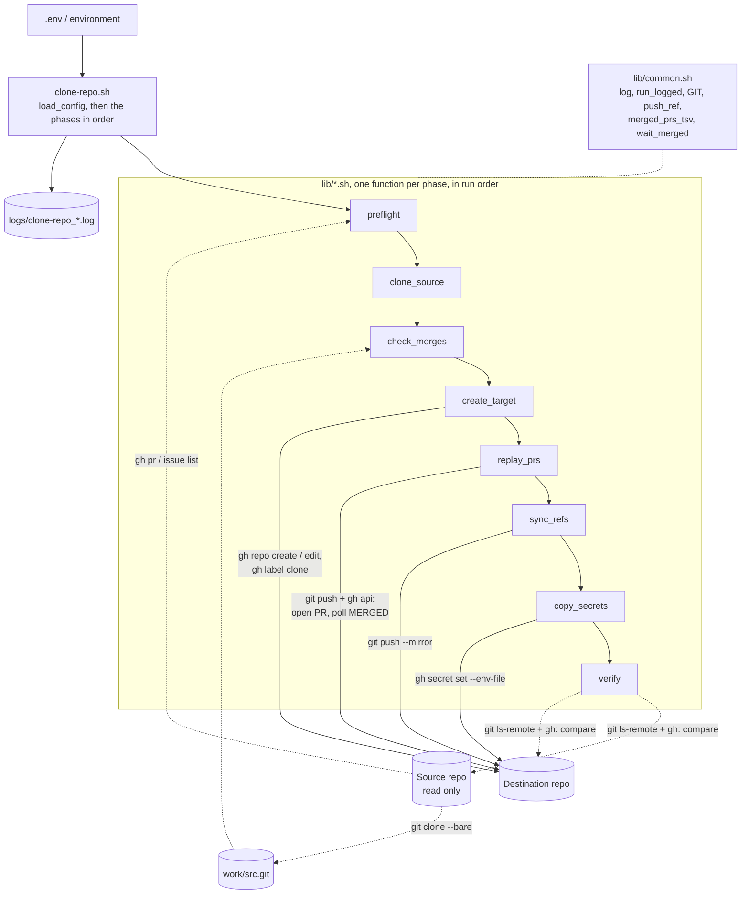

# clone-repo

Copy a GitHub repository to another user or organization. The copy has the **same commit SHAs, branches and tags**, and its **merged pull requests have the same numbers and show as merged** by the original merge commits. Labels, repository settings and (optionally) Actions secrets are copied too. The source repository is only read.

```bash
cp .env.example .env      # set SOURCE_REPO=owner/name and DEST_REPO=other-owner/name
./clone-repo.sh           # copy; run it again later to sync new merged PRs
```

## How it works

Git can copy commits, but not pull requests: those are GitHub objects with their own numbers. clone-repo copies each part with the method that keeps it identical.

1. **History.** A bare clone plus `git push --mirror`, GitHub's documented way to [duplicate a repository](https://docs.github.com/en/repositories/creating-and-managing-repositories/duplicating-a-repository). Every commit keeps its SHA.
2. **Pull requests.** They are replayed into the empty destination in number order, the way each one originally happened:
   1. The base branch is set to the commit just before the merge.
   2. The PR branch is pushed at its head commit.
   3. The PR is opened with the original title and body. GitHub gives it the next number, which is checked to equal the original.
   4. The **original merge commit** is pushed to the base branch.

   GitHub marks a PR as merged when its head commit reaches the base branch by a push ([hub-merge](https://man.archlinux.org/man/hub-merge.1.en)), so each PR ends up MERGED by the same commit as in the source.
3. **Safety.** Before anything is created, `preflight` and `check_merges` stop the run if the source has anything this replay can't reproduce exactly (see [What is and isn't copied](#what-is-and-isnt-copied)). At the end, `verify` compares source and destination and reports PASS or FAIL for each part.

GitHub's own migration tool, the [GitHub Enterprise Importer](https://docs.github.com/en/migrations/using-github-enterprise-importer/migrating-between-github-products/about-migrations-between-github-products), copies PRs too, but its GitHub-to-GitHub migrations target GitHub Enterprise Cloud. clone-repo works with free accounts and organizations. The full mechanics, with a worked example, are in [docs/how-it-works.md](docs/how-it-works.md).

## Features

- Commits, branches and tags copied byte for byte (same SHAs), with the default branch set to match the source.
- Merged PRs recreated with the same number, title, body, head and base branch, head SHA and merge commit, and shown as merged.
- PR conversation comments copied in order, each starting with a line naming the original author and time.
- **Sync:** re-running skips PRs that are already copied and replays only new ones.
- Settings copied: description, issues/projects/wiki toggles, allowed merge methods, delete-branch-on-merge. Labels are copied with `gh label clone`.
- Actions secrets set from a local dotenv file through gh's own import (`gh secret set --env-file`), so values never pass through clone-repo or its logs.
- Preflight refusals: issues, unmerged PRs, fork PRs, numbering gaps, squash/rebase merges, and PRs with reviews, labels, assignees or a milestone. It refuses rather than make a silently incomplete copy.
- `verify` compares refs (branches, tags, `refs/pull/N/head`), PRs, the number of comments on each PR, labels and settings, and warns about missing secret names.
- Timestamped logging to the terminal and to `logs/clone-repo_<timestamp>.log`.
- Any single phase can be run on its own, for example `./clone-repo.sh verify`.

## Technologies

- **bash**, **git** and the **[GitHub CLI](https://cli.github.com/)** (`gh`). gh handles authentication, the REST/GraphQL calls, and jq filtering (its built-in `--jq`). There are no other runtime dependencies.
- **[bats-core](https://github.com/bats-core/bats-core)** for tests, installed with npm. Node.js is only needed to run the tests.

## Requirements

- bash and git: Linux, macOS, or Git Bash on Windows. Tested with Git Bash on Windows 11 (bash 5.3, git 2.55).
- gh 2.x, logged in with `gh auth login`. The token needs the `repo` scope (private repos) and the `workflow` scope (required to push commits that touch `.github/workflows`). Add a scope with `gh auth refresh -s workflow`. Check with `gh auth status`.
- Permission to create repositories in the destination owner. For an organization, that means being an admin or a member allowed to create repos of that visibility.
- Read access to the source repository.

## Setup

```bash
git clone https://github.com/BurnyCoder/clone-repo.git
cd clone-repo
cp .env.example .env
```

Settings go in `.env`. An environment variable of the same name wins over `.env`.

| Setting | Default | Meaning |
|---|---|---|
| `SOURCE_REPO` | (required) | Repo to copy, `owner/name`. Only read. |
| `DEST_REPO` | (required) | Repo to create, `owner/name`. It must not exist yet, or must be an earlier copy (then the run syncs). |
| `DEST_VISIBILITY` | `private` | `private`, `public` or `internal`, used when creating the destination. |
| `SECRETS_ENV_FILE` | (empty) | Optional dotenv file of `NAME=value` Actions secrets to set in the destination. Keep it out of git (`*.secrets.env` is ignored). |
| `MERGE_TIMEOUT_SECONDS` | `60` | How long to wait for GitHub to mark one replayed PR as merged. |
| `POLL_SECONDS` | `2` | Pause between merge-state checks. |
| `WORK_DIR` / `LOG_DIR` | `./work` / `./logs` | Bare clone and comparison files / run logs. |

## Usage

```bash
./clone-repo.sh                                              # full copy, or sync if DEST_REPO exists
SOURCE_REPO=me/app DEST_REPO=my-org/app ./clone-repo.sh      # one-off, without editing .env
./clone-repo.sh preflight                                    # only check whether the source can be copied
./clone-repo.sh verify                                       # only compare source and destination
```

To copy secrets, write a file such as `ci.secrets.env` with `NAME=value` lines, then set `SECRETS_ENV_FILE=ci.secrets.env`. GitHub never returns secret values, so they have to come from you.

**Before you run it:**
- Don't open issues or PRs in the destination while a copy runs, because numbers can't be reused.
- If PRs are opened or merged in the source during a run, `preflight` or `verify` reports it. Run again once it's quiet.
- The pushes can trigger the destination's GitHub Actions workflows that run `on: push` or `on: pull_request`.

## What happens when you run it

| # | Phase | What it does | Writes to GitHub? |
|---|---|---|---|
| 1 | `preflight` | Asks GitHub for the source's issues and PRs. It stops with a list of everything that can't be copied exactly yet. | no |
| 2 | `clone_source` | `git clone --bare` into `work/src.git`. Each run starts fresh. | no |
| 3 | `check_merges` | Checks that each merged PR's merge commit has the PR head as its second parent, which rules out squash and rebase merges. | no |
| 4 | `create_target` | Creates the destination with `DEST_VISIBILITY`, or reuses it on a sync. Copies the description, settings and labels. | yes |
| 5 | `replay_prs` | For each merged PR not yet copied: pushes the base branch and the PR branch, opens the PR, checks its number, copies its comments, pushes the merge commit, waits for MERGED, then deletes the branch. | yes |
| 6 | `sync_refs` | `git push --mirror`, so all branches and tags equal the source's, then sets the default branch. | yes |
| 7 | `copy_secrets` | `gh secret set --env-file` when `SECRETS_ENV_FILE` is set. | yes |
| 8 | `verify` | Snapshots both repos into `work/source_*.txt` and `work/dest_*.txt`, diffs them, and logs PASS/FAIL/WARN. Ends with `ALL CHECKS PASSED`. | no |

Every line is logged with a timestamp, including git and gh output. If a check fails, the differences are in `work/diff_<part>.txt`. The commands each phase runs are in [docs/how-it-works.md](docs/how-it-works.md).

## Architecture



Each phase is one function in its own file, `lib/<phase>.sh`. Only `clone-repo.sh` calls them. Shared helpers are in `lib/common.sh`, and configuration is in `lib/config.sh`.

## What is and isn't copied

**Copied exactly:**
- commits and their SHAs, branches, tags, and the default branch,
- merged PRs: number, title, body, head and base branch, head SHA, merge commit and MERGED state,
- PR conversation comments: the text, in order (author and time go in a first line, see below),
- labels,
- the settings listed under [Features](#features),
- Actions secrets you supply.

**Different in the copy** (the API can't set these):
- PR creation and merge dates are the day of the copy.
- The merge is credited to the account that ran the copy. So are copied comments, each of which starts with a line such as `> Originally posted by @alice on 2026-01-01T00:00:00Z`.
- The merge commit messages still name the source owner ("Merge pull request #N from source-owner/branch"), because they are part of the unchanged commits.

**Refused by preflight, so the run stops before creating anything:**
- issues,
- open or closed-unmerged PRs,
- PRs from forks,
- numbering gaps (deleted issues, discussions),
- squash or rebase merges,
- PRs with reviews (including inline review comments), labels, assignees or a milestone.

Only the newest 1000 PRs are listed per query, so a larger source is refused for numbering. How these could be supported is in [docs/roadmap.md](docs/roadmap.md).

**Not copied:**
- topics and the homepage URL,
- releases (their tags are copied),
- Git LFS objects (see the LFS steps in GitHub's [duplicating a repository](https://docs.github.com/en/repositories/creating-and-managing-repositories/duplicating-a-repository)),
- wiki pages, Projects, discussions, packages,
- Actions variables, environments and run history,
- branch protection and rulesets, webhooks, deploy keys,
- collaborators and teams,
- stars, watchers and forks.

## Testing

```bash
npm install        # installs bats-core into node_modules/
npm test           # or: ./node_modules/.bin/bats test
```

The 19 tests take about 2.5 minutes on Windows, where starting processes is slow, and never touch GitHub:
- **Real local git:** a source repo is built with `git merge --no-ff`, the same as GitHub's merge button, and the destination is an empty local bare repo.
- **Fake `gh`:** `test/stub/gh` recreates the two GitHub behaviours the replay relies on: PR creation fails when there are no commits between base and head, and a PR becomes MERGED once its head is reachable from the base.

How the tests are organized is in [AGENTS.md](AGENTS.md#testing).

## Sources

- GitHub Docs: [Duplicating a repository](https://docs.github.com/en/repositories/creating-and-managing-repositories/duplicating-a-repository), [About pull request merges](https://docs.github.com/en/pull-requests/collaborating-with-pull-requests/incorporating-changes-from-a-pull-request/about-pull-request-merges), [REST: create a pull request](https://docs.github.com/en/rest/pulls/pulls#create-a-pull-request), [About migrations between GitHub products](https://docs.github.com/en/migrations/using-github-enterprise-importer/migrating-between-github-products/about-migrations-between-github-products), [REST rate limits](https://docs.github.com/en/rest/using-the-rest-api/rate-limits-for-the-rest-api).
- Merge detection on push: [hub-merge(1)](https://man.archlinux.org/man/hub-merge.1.en).
- git: [git clone --bare](https://git-scm.com/docs/git-clone#Documentation/git-clone.txt---bare), [git push --mirror](https://git-scm.com/docs/git-push#Documentation/git-push.txt---mirror), [gitrevisions (`^1`, `^2`)](https://git-scm.com/docs/gitrevisions), [gitcredentials](https://git-scm.com/docs/gitcredentials#_custom_helpers).
- gh manual: [gh api](https://cli.github.com/manual/gh_api), [gh pr list](https://cli.github.com/manual/gh_pr_list), [gh repo create](https://cli.github.com/manual/gh_repo_create), [gh repo edit](https://cli.github.com/manual/gh_repo_edit), [gh label clone](https://cli.github.com/manual/gh_label_clone), [gh secret set](https://cli.github.com/manual/gh_secret_set), [gh auth git-credential](https://cli.github.com/manual/gh_auth_git-credential).
- Related tool: [itchyny/github-migrator](https://github.com/itchyny/github-migrator), which keeps numbers but turns PRs into issues.
